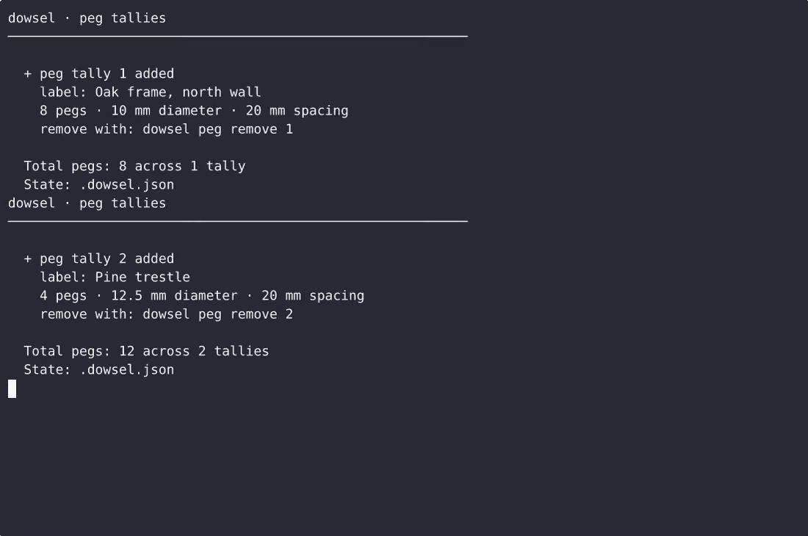
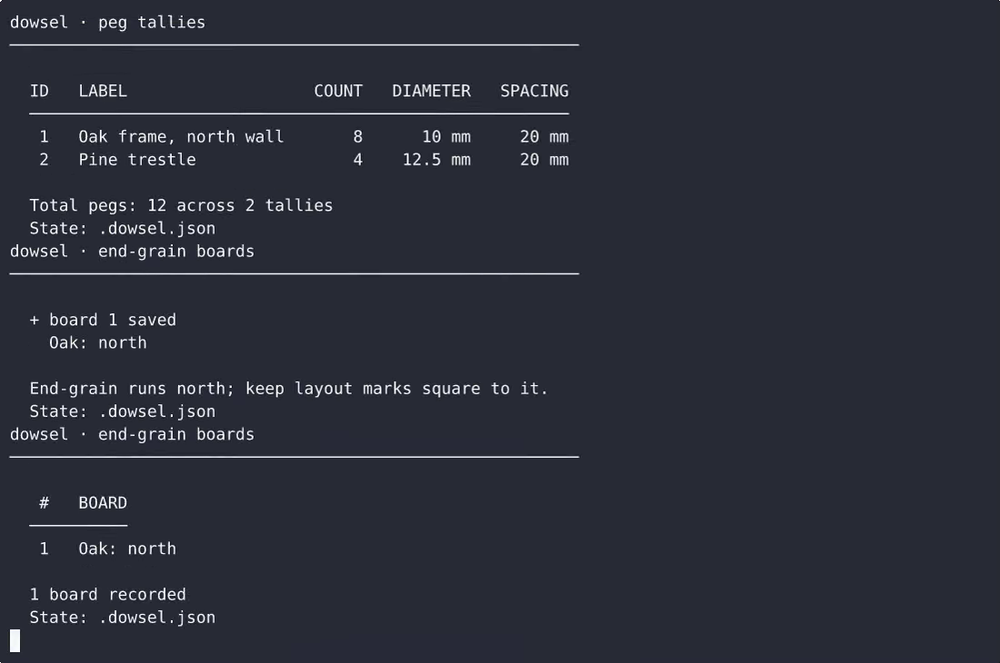

# Dowsel — complete Full-stack app command-line tool example app

**Dowsel** is a free, open-source command-line tool written in Full-stack app. Dowsel is a single-file, standard-library Python CLI for timber joinery: it records and totals joinery pegs per label, tracks each board's end-grain direction, and stores a saw kerf reminder with the computed half-ker…. Every Dowsel file — code, design, seeded demo data — ships in this repository under the Apache-2.0 license. Self-host it, or [remix Dowsel on cenius.ai](https://cenius.ai/marketplace/p/dowsel?ref=gh&utm_campaign=dowsel-webapp) to get a custom build with full rebrand rights.


[](LICENSE)  [](https://cenius.ai)

[](https://cenius.ai/marketplace/p/dowsel?ref=gh&utm_campaign=dowsel-webapp)

> **▶ [Open & edit in cenius.ai](https://cenius.ai/marketplace/p/dowsel?ref=gh&utm_campaign=dowsel-webapp)** — one click to an editable workspace: describe changes in plain English, get an instant preview, one-click deploy and host. Modifications made on the platform come with full rebrand & relicense rights.

_Local clone? See [Quick start](#quick-start) below. cenius.ai is the zero-setup path._

## Demo


📽 **[Watch the walkthrough](https://cenius.ai/marketplace/p/dowsel?ref=gh&utm_campaign=dowsel-webapp)** — plays on cenius.ai · [MP4 file](.github/media/demo.mp4)

## Screenshots

 

## Architecture

A self-contained Full-stack app project (14 files): top-level directories include `tests/`. Run `./install.sh` once to install packages and populate demo data — the app is ready to use immediately after. For environment-specific setup, see [`INSTALL.md`](INSTALL.md).

## Features

- Peg tally
- End-grain direction board
- Saw kerf offset reminder

## Quick start

```bash
./install.sh   # installs dependencies + seeds demo data
```

See [`INSTALL.md`](INSTALL.md) for full setup and usage instructions.

## Usage guide

Three features, one tally file. Every transcript below is real output from
`python3 dowsel.py ...` (the `dowsel` command on PATH behaves identically).

---

### 1. Peg tallies - `dowsel peg`

Record how many joinery pegs of a given diameter and spacing you need, label the
tally, read back the total, and remove a tally when the job is done. Every tally
carries an id, printed when you add it.

#### Empty state

```
$ dowsel peg list

dowsel · peg tallies
──────────────────────────────────────────────────────────

  No peg tallies yet
  Add one:  dowsel peg add 8 --diameter 10 --spacing 20

  State: .dowsel.json
```

#### Add a tally

```
$ dowsel peg add 8 --diameter 10 --spacing 20 --label "Oak frame, north wall"

dowsel · peg tallies
──────────────────────────────────────────────────────────

  + peg tally 1 added
    label: Oak frame, north wall
    8 pegs · 10 mm diameter · 20 mm spacing
    remove with: dowsel peg remove 1

  Total pegs: 8 across 1 tally
  State: .dowsel.json
```

`COUNT` is a positive whole number; `--diameter` and `--spacing` are positive
numbers of millimetres (decimals are fine: `--diameter 12.5`). `--label` is
optional - it is what you will recognise the tally by later:

```
$ dowsel peg add 6 --diameter 8 --spacing 18

  + peg tally 3 added
    6 pegs · 8 mm diameter · 18 mm spacing
    remove with: dowsel peg remove 3
```

#### List every tally and the total

```
$ dowsel peg list

dowsel · peg tallies
──────────────────────────────────────────────────────────

_Full guide: [`USAGE.md`](USAGE.md)_

## FAQ

### What's the quickest way to self-host Dowsel?

It runs entirely on your own machine. Clone, run `./install.sh`, and follow [`INSTALL.md`](INSTALL.md) — the whole stack is in this repo, no external dependencies required.

### How do I customise Dowsel's branding?

Rebranding is straightforward under the MIT license — change what you want in the source. Or [open it on cenius.ai](https://cenius.ai/marketplace/p/dowsel?ref=gh&utm_campaign=dowsel-webapp): the platform handles the changes and grants full rebrand rights on the result.

### What if I want to add features to Dowsel without coding?

Open it on [cenius.ai](https://cenius.ai/marketplace/p/dowsel?ref=gh&utm_campaign=dowsel-webapp) and describe the changes you want in plain English — the platform modifies the app and gives you a new, downloadable build.

### What is Dowsel built with?

Full-stack app. The full source in this repository is exactly what the app runs. Highlights include peg tally.

### Can I use Dowsel in a commercial project?

Confirmed free for commercial use — MIT terms let you incorporate, resell, or ship it in any product. [LICENSE](LICENSE).

## License & rebranding

Released under the [Apache License 2.0](LICENSE) (© 2026 Cenius AI) — free for personal and commercial use. The Cenius name/logo are trademarks (see NOTICE).

**Need a customized version?** [Remix this app on cenius.ai](https://cenius.ai/marketplace/p/dowsel?ref=gh&utm_campaign=dowsel-webapp) — modifications made on the platform come with **full rebrand & relicense rights** over your derivative.

## Built with cenius.ai

This entire application — code, design, seeded demo data — was generated on **[cenius.ai](https://cenius.ai)** from a plain-English description.

- 🚀 [Build your own app on cenius.ai](https://cenius.ai)
- 🎛️ [Remix Dowsel on the marketplace](https://cenius.ai/marketplace/p/dowsel?ref=gh&utm_campaign=dowsel-webapp) — open it in a workspace, prompt for changes, and ship your own version.

More open-source apps: [the Cenius-ai catalog](https://github.com/Cenius-ai) · [showcase index](https://github.com/Cenius-ai/showcase)
